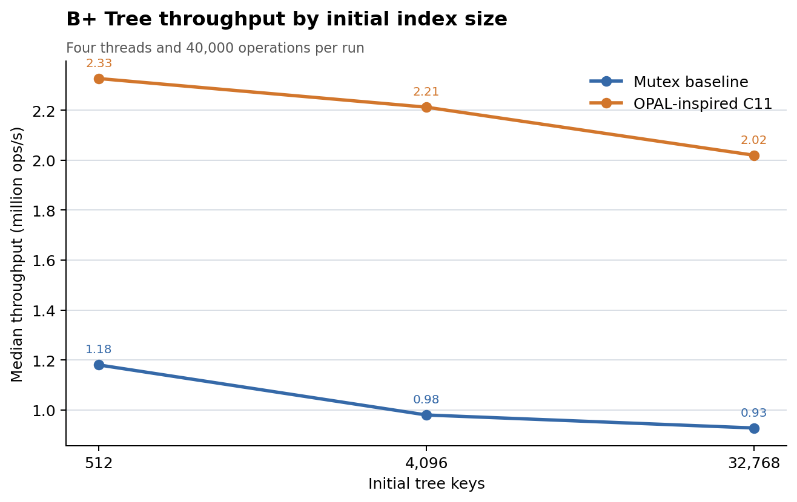

# OPAL-Inspired B+ Tree Index-Size Comparison

## Experiment

This experiment compares the single-mutex baseline with the OPAL-inspired
C11 teaching prototype at three initial tree sizes: 512, 4,096, and 32,768
keys. Each configuration uses four worker threads and 10,000 operations per
thread, with an 80% lookup, 15% update, and 5% insert mix. One warm-up per
strategy and index size is excluded from the CSV. Five measured pairs per
size alternate mutex-first and OPAL-first order.

A new benchmark source accepts initial key count as a command-line argument;
the existing benchmark source remains unchanged. Initial tree creation and
post-run validation are outside the timer. The timer includes worker thread
creation and joining. Each run validates operation counts, the final key
count, update callback totals, and `RESULT: PASS`. The runner refuses to
overwrite an existing CSV or environment snapshot.

## Results

| Initial keys | Mutex median throughput (ops/s) | OPAL-inspired median throughput (ops/s) | OPAL/mutex | OPAL median elapsed (s) | OPAL average retries/run |
|---:|---:|---:|---:|---:|---:|
| 512 | 1,179,944.52 | 2,326,707.28 | 1.97x | 0.017192 | 100,564 |
| 4,096 | 979,659.05 | 2,212,031.76 | 2.26x | 0.018083 | 128,262 |
| 32,768 | 927,619.84 | 2,019,679.66 | 2.18x | 0.019805 | 137,153 |

Across these measured sizes, median throughput declined as the initial tree
grew for both strategies. The OPAL-inspired/mutex throughput ratio varied
from 1.97x to 2.26x. Retries also varied with size. These results describe
one workload, machine, and implementation; they do not establish a general
performance advantage or reproduce the paper. The initial key count changes
the data structure size while work per run remains fixed, but initialization
is not included in elapsed time.

## Preserved artifacts

- Raw measurements: [`results/raw/opal_bptree_index_size.csv`](../results/raw/opal_bptree_index_size.csv)
- Environment: [`results/raw/opal_bptree_index_size_environment_20261102_184130.txt`](../results/raw/opal_bptree_index_size_environment_20261102_184130.txt)
- New benchmark source: [`src/opal_bptree_index_size_benchmark.c`](../src/opal_bptree_index_size_benchmark.c)
- Runner: [`benchmarks/run_opal_bptree_index_size.sh`](../benchmarks/run_opal_bptree_index_size.sh)
- Analyzer source: [`benchmarks/analyze_opal_bptree_index_size.c`](../benchmarks/analyze_opal_bptree_index_size.c)

The runner's named CSV already contains the preserved run and refuses to
overwrite it. To collect another independent run, use a clean project copy
or give the runner and analyzer new output names. The completed validation
commands were:

```bash
bash -n benchmarks/run_opal_bptree_index_size.sh
gcc -std=c11 -Wall -Wextra -Wpedantic -Werror -O2 -pthread -Iinclude \
    src/opal_bptree.c src/opal_bptree_index_size_benchmark.c \
    -o opal_bptree_index_size_benchmark
gcc -std=c11 -Wall -Wextra -Wpedantic -Werror -O2 \
    benchmarks/analyze_opal_bptree_index_size.c -lm \
    -o analyze_opal_bptree_index_size_check
bash benchmarks/run_opal_bptree_index_size.sh
./analyze_opal_bptree_index_size_check
```

The analyzer validated 30 rows and reported `ANALYSIS: PASS`.



Vector version: [SVG](../results/figures/opal_bptree_index_size.svg).
