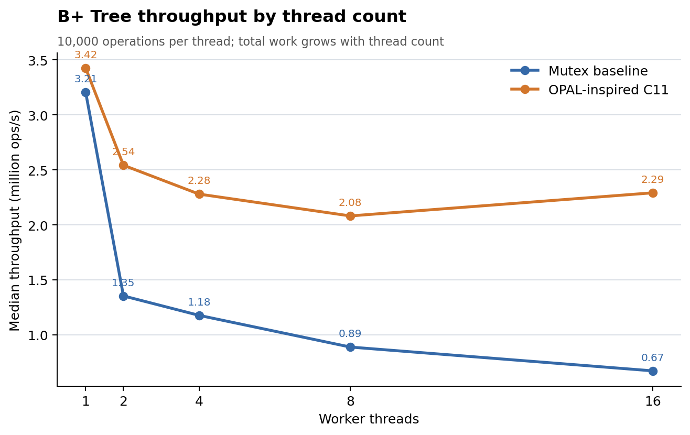

# OPAL-Inspired B+ Tree Thread-Count Sweep

## Experiment

This experiment compares the existing single-mutex B+ Tree baseline with the
local OPAL-inspired C11 teaching prototype at 1, 2, 4, 8, and 16 worker
threads. Each worker performs 10,000 operations with an 80% lookup, 15%
update, and 5% insert mix. Total work therefore grows with thread count.
Each strategy and thread count received one unmeasured warm-up followed by
five measured pairs. Pair order alternated between mutex-first and
OPAL-first. The timer excludes tree initialization and post-run validation,
but includes worker creation and joining.

The runner checks the reported mode, thread and operation counts, final key
count, update callback count, numeric measurements, and `RESULT: PASS` before
recording each row. It refuses to replace its CSV or timestamped environment
snapshot. The analyzer checks the schema, all 50 rows, per-pair order,
operation counts, and throughput calculation before reporting medians.

## Results

| Threads | Mutex median throughput (ops/s) | OPAL-inspired median throughput (ops/s) | OPAL/mutex | OPAL scale from 1 thread | OPAL average retries/run |
|---:|---:|---:|---:|---:|---:|
| 1 | 3,206,270.95 | 3,424,889.77 | 1.07x | 1.00x | 0 |
| 2 | 1,354,085.05 | 2,541,820.25 | 1.88x | 0.74x | 49,587 |
| 4 | 1,177,372.35 | 2,279,397.10 | 1.94x | 0.67x | 98,098 |
| 8 | 889,288.84 | 2,081,030.98 | 2.34x | 0.61x | 161,762 |
| 16 | 672,878.18 | 2,291,111.00 | 3.40x | 0.67x | 335,179 |

In this run, both implementations had lower median throughput beyond one
thread; the OPAL-inspired version's median was higher than the mutex
baseline at 2, 4, 8, and 16 threads. Its throughput recovered somewhat at
16 versus 8 threads, while retries also increased. This is one machine and
one workload. Since total work grows with thread count, the scale ratios are
throughput ratios for this fixed-work-per-thread design, not fixed-total-work
parallel speedup. The recorded executable's original compiler flags could
not be independently confirmed. These data do not establish a general
performance result or reproduce the research paper.

## Preserved artifacts and commands

- Raw measurements: [`results/raw/opal_bptree_thread_scaling.csv`](../results/raw/opal_bptree_thread_scaling.csv)
- Environment: [`results/raw/opal_bptree_thread_scaling_environment_20261028_232122.txt`](../results/raw/opal_bptree_thread_scaling_environment_20261028_232122.txt)
- Runner: [`benchmarks/run_opal_bptree_thread_scaling.sh`](../benchmarks/run_opal_bptree_thread_scaling.sh)
- Analyzer source: [`benchmarks/analyze_opal_bptree_thread_scaling.c`](../benchmarks/analyze_opal_bptree_thread_scaling.c)

Reproduce the run only after moving to a new output name or working copy,
because the runner intentionally refuses to overwrite the preserved CSV.
The completed validation commands were:

```bash
bash -n benchmarks/run_opal_bptree_thread_scaling.sh
gcc -std=c11 -Wall -Wextra -Wpedantic -Werror -O2 \
    benchmarks/analyze_opal_bptree_thread_scaling.c -lm \
    -o analyze_opal_bptree_thread_scaling_check
bash benchmarks/run_opal_bptree_thread_scaling.sh
./analyze_opal_bptree_thread_scaling_check
```

The analyzer validated 50 measurements and reported `ANALYSIS: PASS`.



Vector version: [SVG](../results/figures/opal_bptree_thread_scaling.svg).
