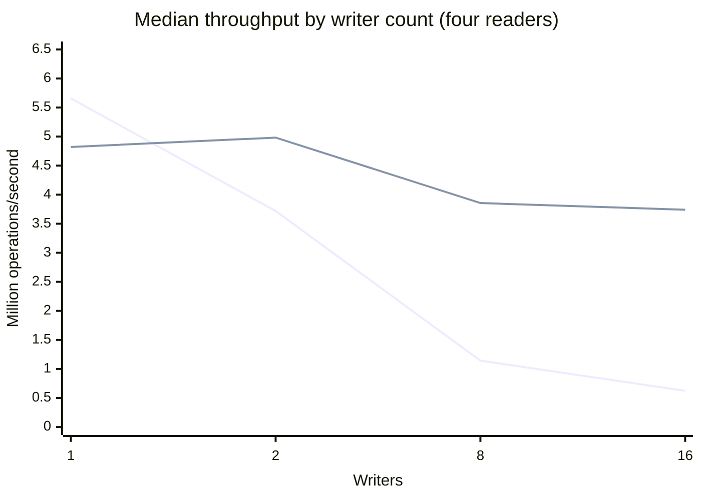
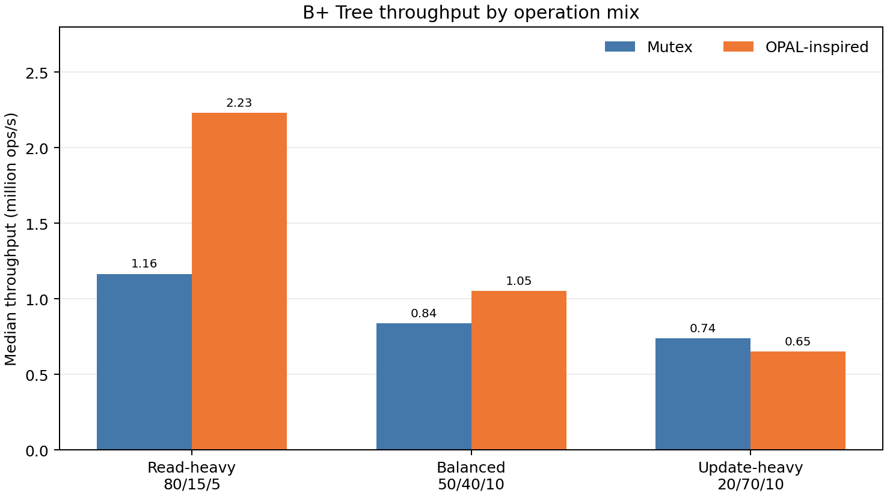
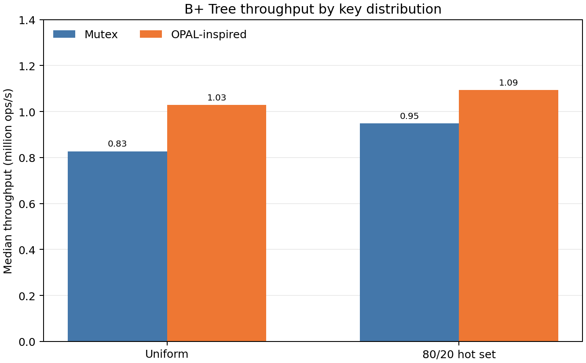
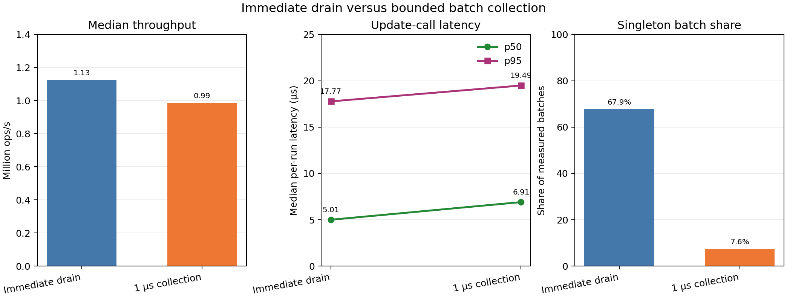
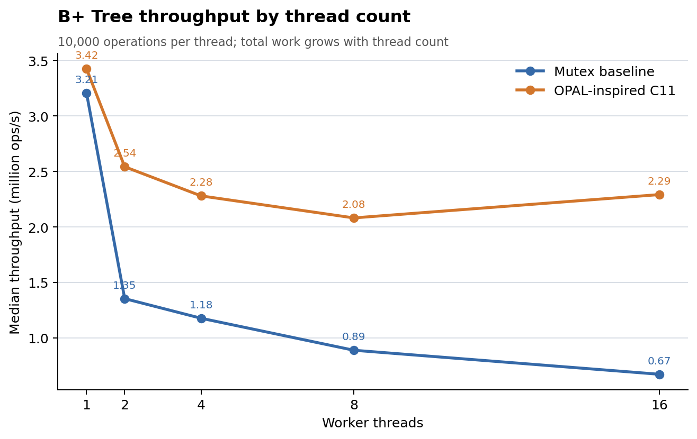
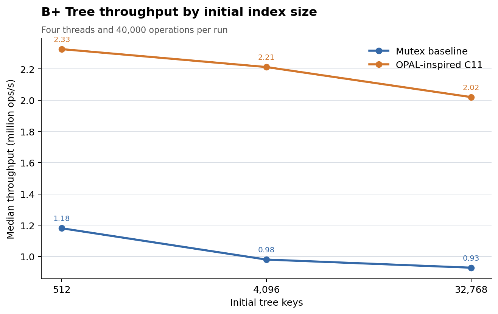

# Operation-Aware Locking: OS Concurrency Project Report

## Abstract

This project studies how synchronization affects correctness, retries,
latency, and throughput in C11 shared-memory workloads. It includes pthread
and counter exercises, optimistic version validation, a reader/writer hybrid,
and a concurrent integer-key B+ Tree teaching prototype with optimistic
lookups, function-pointer update combining, and MCS serialization for update
batches and inserts. The benchmarks compare these strategies across workload
mixes and key distributions, and measure update batch sizes and a separate
bounded collection-window experiment. All reported measurements are local
to the recorded machine and build. The B+ Tree is an OPAL-inspired adaptation;
this project does not reproduce OPAL's implementation or paper results.

## Research background

The project is inspired by Gupta et al.'s *Operation-Aware Hybrid Locking
for Modern In-Memory Indexes* (PVLDB 19(8), 2026). The paper describes OPAL
as selecting synchronization by operation type: optimistic version checks
for read-only lookups, function-pointer-based batching for updates, and
MCS-style locking for structural modification operations. It evaluates the
design on B+ Tree and Adaptive Radix Tree indexes. The paper reports up to
2.43× throughput improvement and 80% latency reduction against its
state-of-the-art optimistic-locking baseline. These are paper-reported
results, not results of this project. [Paper and DOI](https://doi.org/10.14778/3811243.3811253),
[open PDF](https://vishalgupta.cc/publications/2026-opal/opal.pdf),
[artifact repository](https://github.com/rs3lab/opal).

## Problem and objectives

The project asks how synchronization choices behave under read-heavy
workloads with concurrent updates, and how contention indicators such as
optimistic retries change as writer load increases. Its objectives are to:

- demonstrate pthreads, data races, mutexes, and C11 atomics;
- implement and check version-based optimistic reads;
- preserve raw repeated measurements and use warm-ups and alternating run
  order for newer comparisons;
- vary writer count while holding reader count and per-thread iterations
  constant;
- implement a small reader/writer hybrid inspired by operation-aware
  synchronization and compare it with two teaching baselines;
- build a concurrent B+ Tree teaching prototype with operation-specific
  synchronization paths and assess its behavior under varied workload mixes,
  key distributions, and update-batch policies.

## Scope and implementation status

| Status | Components |
|---|---|
| Implemented | Thread create/join examples; intentional race demonstration; mutex and atomic counters; critical-section example; thread scaling; mutex-versus-atomic comparison; version-based optimistic reads; mutex and optimistic benchmarks; balanced comparison harness; read-heavy, balanced, and update-heavy writer-count experiments; reader/writer hybrid benchmark; concurrent integer-key B+ Tree; correctness test; workload-mix, hot-key, batch-metrics, batch-policy, thread-count, and index-size experiments. |
| Adapted from OPAL concepts | The B+ Tree uses a global version counter for optimistic lookups, function-pointer update requests with a combiner, and a global MCS writer queue for update batches and inserts. A separate experiment clone applies a nominal 1 μs collection window before detaching a nonempty update batch. |
| Not implemented | Upstream OPAL lock word and per-node protocol; its full B+ Tree or ART implementation; memory reclamation; deletes and range scans; NUMA-aware coordination; PiBench integration; full paper reproduction. |

The teaching workloads update a two-integer record with invariant
`value_b == -value_a`. They are not index workloads and do not measure tree
traversal, node splits, cache-line movement, fairness, or starvation.

## Synchronization design

The optimistic benchmark uses an even version to indicate that no writer is
active and an odd version while a writer updates the record. Readers load
the version, read both atomic fields, and accept the snapshot only when the
version is unchanged and even. Otherwise, they retry. Writers are serialized
by an `atomic_flag` in the optimistic baseline.

The reader/writer hybrid benchmark retains the version protocol and atomic
shared fields, but serializes writers with a `pthread_mutex_t`. Readers remain
optimistic and do not acquire that mutex. The all-mutex baseline instead
protects both reader and writer accesses with one pthread mutex. The benchmark
modes are therefore:

1. Optimistic readers; `atomic_flag` writer serialization.
2. Optimistic readers; pthread-mutex writer serialization.
3. Pthread-mutex readers and writers.

The reader/writer hybrid is a separate limited prototype. It does not
implement OPAL's batching or MCS mechanisms. The B+ Tree prototype described
below explores those operation categories in a separate implementation.

### OPAL-inspired B+ Tree paths

The B+ Tree baseline protects lookups, updates, and inserts with one pthread
mutex. Its operation-aware mode validates optimistic lookup traversals against
a global version, sends updates through a function-pointer request combiner,
and serializes update batches and insert/split operations through a global
MCS writer queue. Atomic node fields avoid C data races during optimistic
traversal; nodes are retained until tree destruction. These are teaching
adaptations of OPAL's operation categories, not its per-index-node design.

The immediate-drain combiner's measured batches are usually small. A separate
source clone tests a nominal 1 μs spin collection window. That policy is an
experiment, not the default implementation. See the dedicated B+ Tree notes
for [workload mixes](opal_bptree_workload_mix_results.md),
[hot-key distribution](opal_bptree_hotkey_results.md),
[batch-size metrics](opal_bptree_batch_metrics.md), and the
[collection-window comparison](opal_bptree_batch_policy_results.md).

## Project files

- `src/`: C11 concurrency examples and benchmark implementations.
- `tests/`: counter, optimistic-lock, hybrid, and B+ Tree correctness tests.
- `benchmarks/`: shell runners and C analyzers for scaling, synchronization,
  locking comparisons, workload mixes, contention, and the B+ Tree
  experiments.
- `results/raw/`: preserved CSV measurements and timestamped environment
  snapshots.
- `docs/benchmark_reproducibility.md`: reproduction instructions for the
  earlier optimistic-versus-mutex comparison.
- `docs/operation_aware_extension.md`: hybrid extension details and results.
- `docs/opal_bptree_teaching_prototype.md`: B+ Tree design, correctness, and
  baseline measurement details.
- `docs/opal_bptree_*_results.md` and related notes: B+ Tree workload,
  contention, batch-size, and collection-policy measurements.

## Experimental setup and method

The recorded machine was Ubuntu 24.04.4 LTS with Linux kernel
7.0.0-34-generic, an Intel Core i7-14700 CPU, 28 logical CPUs, and GCC
13.3.0. The operation-aware hybrid source was built using
`-std=c11 -Wall -Wextra -Wpedantic -O2 -pthread`. Earlier benchmark
executables were already present; their original build flags could not be
recovered. Timestamped files under `results/raw/` record environment and
workload information for the newer experiments.

For the record-based benchmarks, each reader performs 200,000 successful
reads and each writer performs 100,000 updates. The newer record comparisons
use one warm-up per mode, excluded from the CSV, and five measured runs per
mode. The balanced two-mode harness alternates which strategy runs first in
each pair. The three-mode hybrid harness rotates the order among modes. Each
raw run is retained. The timer starts before thread creation and stops after
joining, so elapsed time and throughput include thread creation/join
overhead. Throughput counts
successful reads plus completed updates; retry attempts are reported
separately.

### Earlier synchronization exercises

The earlier counter and scaling stages establish basic behavior and are
kept separate from the later locking comparisons. The thread-scaling CSV
contains five runs per thread count:

| Threads | Median elapsed time (s) | Median throughput (ops/s) |
|---:|---:|---:|
| 1 | 0.013218 | 75,654,410.65 |
| 2 | 0.029108 | 68,709,633.09 |
| 4 | 0.042101 | 95,009,619.72 |
| 8 | 0.079012 | 101,250,442.97 |

The mutex-versus-atomic counter experiment collected 40 rows. Its median
throughputs were:

| Threads | Mutex (ops/s) | Atomic (ops/s) |
|---:|---:|---:|
| 1 | 25,230,862.39 | 92,030,185.90 |
| 2 | 20,919,626.79 | 60,038,424.59 |
| 4 | 14,856,302.41 | 91,996,320.15 |
| 8 | 13,400,200.33 | 91,795,754.45 |

These are small counter demonstrations and do not represent index
performance. They illustrate the cost of serializing a shared counter under
the tested conditions.

The isolated optimistic benchmark's historical five-run median was
14,204,891.70 operations/second, with 1,750,650.40 average retries per run.
The earlier fixed-order comparison reported 3,325,803.79 median optimistic
throughput and 5,031,642.74 median mutex throughput. In that set, all
optimistic runs preceded all mutex runs and there was no warm-up or recorded
environment snapshot. These historical measurements should not be mixed
with later balanced runs as if they were collected under identical
conditions.

### Workload mix and writer-count measurements

All four measurements use four readers. The writer count changes from one
to 2, 8, and 16, giving 100,000, 200,000, 800,000, and 1,600,000 updates
respectively. Each configuration has five measured pairs and its own raw
CSV. The table reports per-workload medians and optimistic retry counts.

| Writers | Workload | Reads | Updates | Optimistic median throughput (ops/s) | Mutex median throughput (ops/s) | Optimistic average retries/run |
|---:|---|---:|---:|---:|---:|---:|
| 1 | Read-heavy, 8:1 | 800,000 | 100,000 | 5,656,652.22 | 4,821,280.00 | 985,725.20 |
| 2 | Baseline, 4:1 | 800,000 | 200,000 | 3,719,119.98 | 4,981,554.38 | 1,893,276.00 |
| 8 | Balanced, 1:1 | 800,000 | 800,000 | 1,143,459.71 | 3,855,746.25 | 2,176,451.20 |
| 16 | Update-heavy, 1:2 | 800,000 | 1,600,000 | 623,504.96 | 3,740,894.71 | 2,932,709.00 |

The normalized optimistic retry count rose from 1.232 to 3.666 retries per
successful read between the 1-writer and 16-writer cases. In these runs,
optimistic throughput also declined in the heavier-update configurations.
Retry counts indicate validation work; they do not represent completed
operations that failed. The workloads have different update and total
operation counts, so strategy results should be compared within each
configuration.

The following chart lists the median throughput series in the order
optimistic, then mutex. Values are millions of operations per second and are
derived from the preserved CSV measurements.

### Operation-aware hybrid comparison

For four readers and two writers, the three-mode comparison validated 15
measurements, five per strategy. This is a separately collected run from the
two-mode 4-reader/2-writer baseline above.

| Strategy | Median elapsed time (s) | Median throughput (ops/s) | Average read retries/run |
|---|---:|---:|---:|
| Optimistic readers, `atomic_flag` writer lock | 0.248739 | 4,020,273.24 | 2,078,360.20 |
| Optimistic readers, `pthread_mutex` writer lock | 0.138801 | 7,204,576.38 | 189,495.20 |
| `pthread_mutex` for readers and writers | 0.197612 | 5,060,410.42 | 0 |

The hybrid mode's median throughput was 1.79× the optimistic spin-writer
mode and 1.42× the all-mutex mode in this run. It also recorded fewer
optimistic read retries than the spin-writer mode. The comparison covers one
workload and one machine; it does not establish a general performance
ranking.

### OPAL-inspired B+ Tree experiments

The separate integer-key B+ Tree benchmark uses four threads and 10,000
operations per thread. Its operation-aware path uses optimistic lookups,
function-pointer update combining, and a global MCS writer queue for updates
and inserts. The baseline uses one pthread mutex for all operations. The
workload-mix and hot-key runners each perform one warm-up per strategy and
five alternating measured pairs; setup and verification are outside the
timer, while worker creation and joining are included.

The workload-mix measurements validated 30 rows. Each entry below is the
median throughput over five runs per strategy and workload.

| Workload | Mix (lookup/update/insert) | Mutex (ops/s) | OPAL-inspired (ops/s) | Ratio |
|---|---:|---:|---:|---:|
| Read-heavy | 80/15/5 | 1,163,917.23 | 2,229,041.36 | 1.92× |
| Balanced | 50/40/10 | 836,159.74 | 1,051,924.82 | 1.26× |
| Update-heavy | 20/70/10 | 737,864.95 | 650,019.44 | 0.88× |

The prototype led on the first two mixes and trailed the mutex baseline on
the update-heavy mix. These results are limited to this data structure,
machine, and run series. See the
[workload-mix report](opal_bptree_workload_mix_results.md) and its raw
[`CSV`](../results/raw/opal_bptree_mix_sweep.csv).

Vector version: [SVG](../results/figures/opal_bptree_workload_throughput_final.svg).

The hot-key experiment held the balanced 50/40/10 mix fixed and routed 80%
of lookup/update accesses to 20% of the 512 initial keys in its skewed case.
It validated 20 rows. OPAL-inspired median throughput was 1,028,236.48 ops/s
under uniform access (1.24× mutex) and 1,093,153.13 ops/s under the 80/20 hot
set (1.15× mutex). This one run series does not establish a causal effect of
key skew. Details and raw measurements are in the
[hot-key report](opal_bptree_hotkey_results.md) and
[`CSV`](../results/raw/opal_bptree_hotkey_comparison.csv).

Vector version: [SVG](../results/figures/opal_bptree_hotkey_throughput_final.svg).

Batch-size instrumentation on the immediate-drain policy found a 72.01%
singleton-batch share across measured batches, with median maximum batch size
four. These measurements add atomic counter updates and should not be
compared directly with earlier uninstrumented throughput. See the
[batch-metrics report](opal_bptree_batch_metrics.md) and its
[`CSV`](../results/raw/opal_bptree_batch_metrics_low_overhead.csv).

A separate source clone applied a nominal 1 μs spin collection window before
each nonempty batch detach. Compared with immediate drain, it lowered the
singleton share from 67.92% to 7.58%, while median throughput fell to 0.877×
and update-call median and p95 latencies rose by 38.01% and 9.64%, respectively.
The added collection wait was not a performance win in this run. Latency
sampling affects both policies, and the result does not establish how other
window sizes or workloads behave. See the
[collection-policy report](opal_bptree_batch_policy_results.md) and its
[`CSV`](../results/raw/opal_bptree_batch_policy_comparison_per_batch.csv).

Vector version: [SVG](../results/figures/opal_bptree_batch_policy_final.svg).

Two additional sweeps varied worker count and initial index size. Both used
the 80/15/5 lookup/update/insert mix, one warm-up per strategy/configuration,
and five alternating measured pairs. The thread-count sweep held work at
10,000 operations per thread, so total operations increased with thread
count. The index-size sweep held four threads and 40,000 total operations
constant while changing the initial key count. Tree setup and result
validation were outside the timed interval; thread creation and join were
inside it.

| Sweep | Setting | Mutex median ops/s | OPAL-inspired median ops/s | OPAL/mutex |
|---|---:|---:|---:|---:|
| Threads | 1 | 3,206,270.95 | 3,424,889.77 | 1.07× |
| Threads | 2 | 1,354,085.05 | 2,541,820.25 | 1.88× |
| Threads | 4 | 1,177,372.35 | 2,279,397.10 | 1.94× |
| Threads | 8 | 889,288.84 | 2,081,030.98 | 2.34× |
| Threads | 16 | 672,878.18 | 2,291,111.00 | 3.40× |
| Initial keys | 512 | 1,179,944.52 | 2,326,707.28 | 1.97× |
| Initial keys | 4,096 | 979,659.05 | 2,212,031.76 | 2.26× |
| Initial keys | 32,768 | 927,619.84 | 2,019,679.66 | 2.18× |

These are separate measurement series and should not be compared against
each other as equivalent workloads. In the thread sweep, throughput per
second decreased after one thread for both modes; the OPAL-inspired median
recovered slightly at 16 threads relative to eight. In the index-size sweep,
both modes' medians declined as the initial tree grew. The ratios are
observations from one machine and run series, not general performance
claims. See the [thread-count report](opal_bptree_thread_scaling_results.md)
and [index-size report](opal_bptree_index_size_results.md), with their
preserved [thread CSV](../results/raw/opal_bptree_thread_scaling.csv) and
[index CSV](../results/raw/opal_bptree_index_size.csv).

Vector version: [SVG](../results/figures/opal_bptree_thread_scaling.svg).

Vector version: [SVG](../results/figures/opal_bptree_index_size.svg).

These figures are rendered from the preserved CSVs with Matplotlib 3.6.3 as
report artifacts; the benchmark and analyzer workflow remains C and shell.

## Correctness and testing evidence

- `tests/check_counters.sh`: ten mutex-counter and ten atomic-counter runs
  passed with the expected final count.
- `tests/test_optimistic_lock.sh`: ten runs passed with final values
  200,000 and -200,000, final version 400,000, and zero invalid snapshots.
- `tests/test_writer_mutex_optimistic_reader.sh`: three runs each at 4/2 and
  4/16 reader/writer counts passed expected-count, version, and snapshot
  checks.
- `tests/test_opal_bptree.c`: concurrent lookups, updates, split inserts,
  final key count, values, and callback totals passed in mutex and
  OPAL-inspired modes. The four workload experiment runners also required
  each benchmark run to report `RESULT: PASS` and validated operation counts.
- All four workload CSV analyzers and the cross-workload analyzer reported
  `ANALYSIS: PASS`; the operation-aware analyzer validated 15 rows.
- The B+ Tree workload-mix, hot-key, batch-metrics, and batch-policy
  analyzers each reported `ANALYSIS: PASS` for 30, 20, 10, and 10 measured
  rows, respectively.
- The B+ Tree thread-count and index-size analyzers each reported
  `ANALYSIS: PASS` for 50 and 30 measured rows, respectively.
- AddressSanitizer and UndefinedBehaviorSanitizer checks of the B+ Tree
  passed with leak detection disabled. LeakSanitizer terminated with an
  environment-level fatal error. GCC ThreadSanitizer completed the B+ Tree
  correctness test three consecutive times using a non-PIE build and
  per-process ASLR disabling; no race reports appeared. Other launches
  failed during TSan startup with `unexpected memory mapping`. Clang is
  unavailable, so this evidence is from GCC only.

Sanitizer results and repeated tests are evidence for the tested runs, not
formal proofs. Atomic fields and sequentially consistent operations were
retained in the optimistic reader paths.

## Limitations and threats to validity

- The B+ Tree prototype is a small teaching adaptation with a global version
  and global MCS writer queue; it is not the paper's per-node OPAL design.
- Thread counts were sampled from 1 to 16, and initial sizes from 512 to
  32,768 keys. These limited sweeps do not cover all scales; fairness and
  starvation were not measured.
- The bounded collection-window variant is an isolated experiment clone and
  uses a nominal busy-spin interval. It is not the default policy.
- Batch counters and per-update latency sampling add measurement overhead.
- CPU frequency, scheduling, thermal state, and background load can affect
  timings. Alternating order and warm-ups reduce some bias but cannot remove
  it.
- The existing baseline executables' build flags were not recoverable.
- The timer includes thread creation and joining.
- The operation-aware hybrid comparison has one five-run sample per mode at
  one workload; it should be repeated on other machines and configurations.
- Exceptional pthread failure recovery in the update combiner is limited;
  callers must not destroy a tree while operations are in flight.
- Results from different workload configurations are not interchangeable.

## Conclusion and future work

The project combines core concurrency exercises with a tested C11 B+ Tree
teaching adaptation and preserved repeated measurements. The results show
that workload mix and update batching policy affect throughput and latency in
this implementation. The bounded collection window formed fewer singleton
batches but reduced throughput and increased measured update latency on this
machine. These findings describe the recorded workloads and do not establish
a general performance ranking or reproduce OPAL's paper results.

Further work could collect more runs across machines, obtain cross-compiler
ThreadSanitizer evidence with Clang when available, and measure fairness with
an explicit method. Reproducing the paper would require
the upstream per-node synchronization design, broader index workloads, and
its evaluation setup; that work is outside this project's current scope.

## References

Gupta, V., Sanchez Lopez, M., Laforet, V., Lozi, J.-P., and Kashyap, S.
2026. “Operation-Aware Hybrid Locking for Modern In-Memory Indexes.”
Proceedings of the VLDB Endowment 19(8): 1804–1817.
[doi:10.14778/3811243.3811253](https://doi.org/10.14778/3811243.3811253).
The paper's reported 2.43× throughput improvement and 80% latency reduction
belong to its evaluation and are not results of this project.
